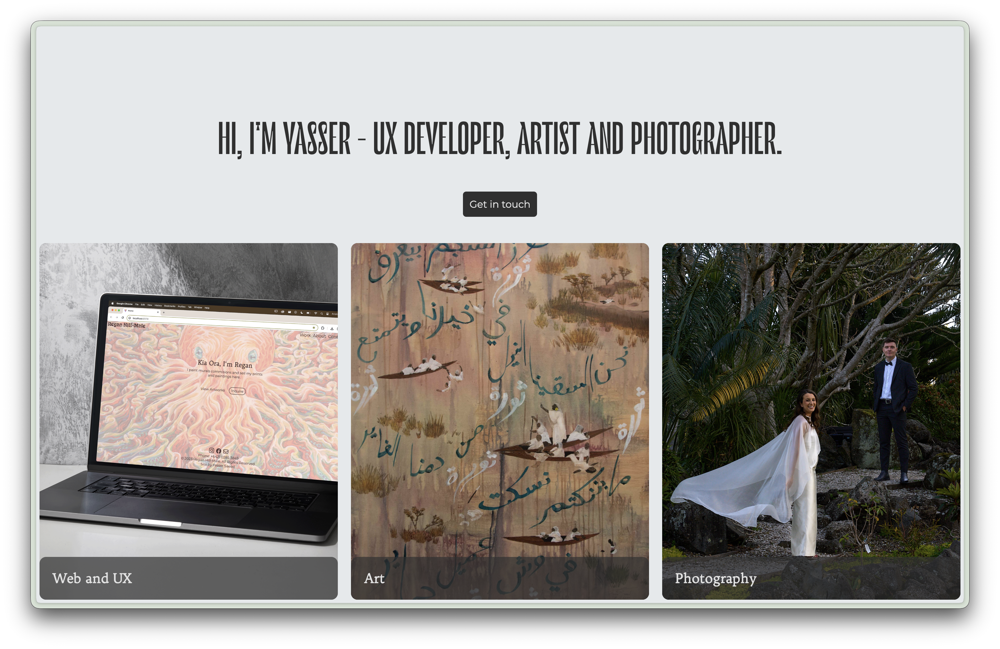

# Yasser Saeed Portfolio

Live sites:

- https://yassersaeed.com/
- https://portfolio-yassoori.vercel.app/



A React portfolio for UX and web development projects, artwork, and photography. The frontend is built with Vite and retrieves public content and product data from a headless WordPress/WooCommerce backend.

## Requirements

- Node.js 24 LTS
- npm
- A WordPress site providing the REST API, custom portfolio routes, WooCommerce Store API, and Contact Form 7 endpoint used by the app

## Local setup

```bash
npm ci
cp .env.example .env.local
```

Edit `.env.local` with the correct public WordPress URLs and Contact Form 7 form ID. These `VITE_` values are compiled into browser code, so never put passwords, API secrets, or private credentials in them.

Start the development server:

```bash
npm run dev
```

Vite prints the local URL, usually http://localhost:5173/.

## Build and deploy

```bash
npm run build
npm run preview
```

`npm run build` recompiles `src/css/App.scss` and its imported Sass modules into `src/css/App.css`, then creates the static production site in `dist/`. Edit the Sass source files rather than editing the generated CSS directly. The development server currently reads the compiled CSS file; after changing Sass while developing, run `npm run styles:build` to refresh it.

For Vercel, configure the same `VITE_` variables in the project’s environment-variable settings for each environment, then deploy. For cPanel, build with the production variables and upload the **contents** of `dist/` into the public web root. If WordPress is installed in that same root, preserve its files and merge `public/.htaccess` rules with the existing cPanel/WordPress rules rather than overwriting the existing file.

The Apache rules serve existing WordPress files and send `/wp-json/` requests to WordPress; other paths fall back to the React app so direct visits to client-side routes work. Confirm the REST API, `/wp-admin/`, frontend routes, and Contact Form 7 submission after deployment.

## Project commands

| Command | Purpose |
| --- | --- |
| `npm run dev` | Start Vite in development mode |
| `npm run styles:build` | Compile Sass to the CSS file used by the app |
| `npm run build` | Compile Sass and create the static production build |
| `npm run preview` | Preview the most recent production build locally |
| `npm run lint` | Run ESLint; the repository needs an ESLint configuration for this command to work |

## Main dependencies

Dependency versions and the complete dependency list are maintained in [package.json](./package.json). The app uses React, React Router, Vite, Axios, Sass, React Helmet, AOS, Bootstrap icons, and Font Awesome.
